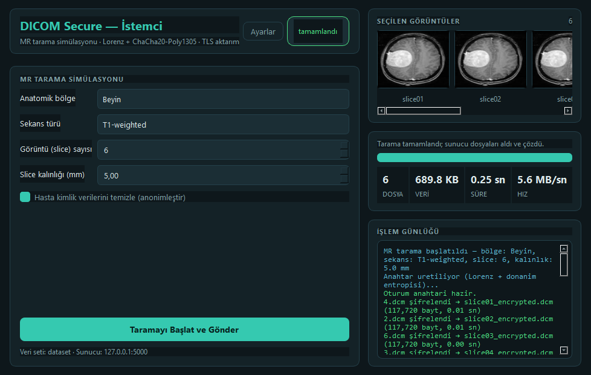
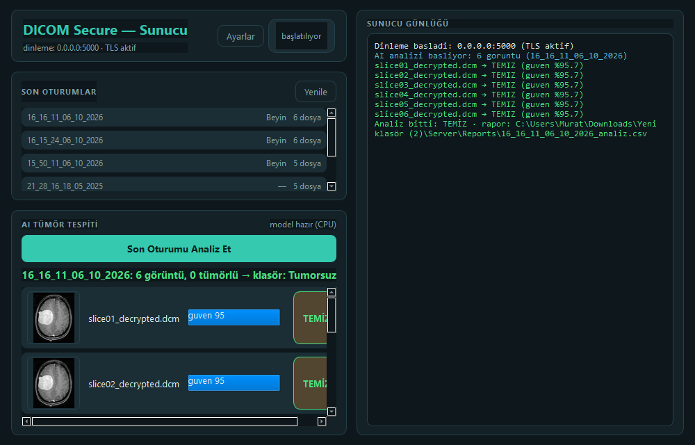

# DICOM Secure — Lorenz + ChaCha20-Poly1305 ile Güvenli Tıbbi Görüntü Aktarımı

[](https://www.python.org/)
[](https://www.riverbankcomputing.com/software/pyqt/)
[](tests/test_pipeline.py)

İki cihaz (ör. 2× **Raspberry Pi 5**) arasında MR görüntülerini **kaotik sistem
destekli anahtar üretimi** ve **kimlik doğrulamalı akış şifrelemesi** ile
şifreleyip **TLS** üzerinden aktaran, grafik arayüzlü istemci-sunucu sistemi.
Sunucu tarafında şifresi çözülen görüntüler yapay zekâ ile **tümör tespitinden**
geçer.

| İstemci — şifreleme ve gönderim | Sunucu — çözme ve AI tümör tespiti |
|---|---|
|  |  |

## Ne yapar?

1. **İstemci**, kullanıcıdan MR parametrelerini alır (bölge, sekans, slice
   sayısı/kalınlığı), yerel DICOM havuzundan rastgele görüntüler seçer.
2. Her görüntü için **Lorenz kaotik sistemi** çözülür, çıktı donanım
   entropisiyle karıştırılıp HKDF ile anahtar türetilir ve piksel verisi
   **ChaCha20-Poly1305** ile şifrelenir. Hasta kimlik etiketleri anonimleştirilir.
3. Şifreli dosyalar + anahtar dosyaları **TLS 1.2+** kanalından özel bir
   oturum protokolüyle sunucuya gönderilir; sunucu her dosyanın bütünlüğünü
   doğrulayarak çözer.
4. **Sunucu**, çözülen görüntüleri PyTorch tabanlı bir CNN ile sınıflandırır:
   güven skoru, TÜMÖR/TEMİZ kararı, CSV raporu ve klasör ayrımı.

```
┌───────────── İSTEMCİ (Raspberry Pi 1) ─────────────┐         ┌──────────── SUNUCU (Raspberry Pi 2) ────────────┐
│  MR simülasyonu → DICOM seçimi                     │         │  Dinleme (TLS 1.2+, CA pinli)                   │
│      ↓                                             │         │      ↓                                          │
│  Lorenz(solve_ivp) ⊕ os.urandom → HKDF → anahtar   │   TLS   │  Uzunluk-onekli protokol v2 (HELLO/META/SIZE)   │
│      ↓                                             │  ─────► │      ↓                                          │
│  ChaCha20-Poly1305 (AEAD) + anonimleştirme         │  port   │  AEAD doğrulama → çözme (tahrifatta RED)        │
│      ↓                                             │  5000   │      ↓                                          │
│  session_meta + .key (JSON)                        │         │  PyTorch CNN → TÜMÖR/TEMİZ + CSV rapor          │
└────────────────────────────────────────────────────┘         └─────────────────────────────────────────────────┘
```

## Güvenlik modeli

Projenin ilk sürümü (Mayıs 2025, `Makale.docx`) yalnızca MAC'siz ChaCha20
kullanıyor, anahtar dosyalarını **şifresiz TCP** ile gönderiyor ve tüm
dosyaları tek deterministik anahtarla şifreliyordu. Bu sürüm (v2) bu
zafiyetlerin tamamını kapatır:

| Katman | v1 (eski) | v2 (bu sürüm) |
|---|---|---|
| Piksel şifreleme | ChaCha20 (MAC yok) | **ChaCha20-Poly1305 AEAD** — tahrifatta çözme reddedilir |
| Anahtar üretimi | Sabit Lorenz başlangıcı | **Rastgele Lorenz başlangıcı ⊕ `os.urandom` → HKDF-SHA256** |
| Anahtar çeşitliliği | Tüm dosyalar aynı anahtar, deterministik nonce | Oturum ana anahtarı + **dosya başına HKDF alt anahtarı** + rastgele 96-bit nonce |
| Aktarım | Düz TCP (anahtarlar açık kanaldan!) | **TLS 1.2+**, istemci CA'yı pinler |
| Hasta verisi | DICOM başlığında açık | **İstemcide anonimleştirme** (PatientName/ID/Doğum tarihi vb.) |
| Bütünlük | Yok | AAD dosya adı/şekil/dtype'ı bağlar; `InvalidTag` → dosya reddi |
| Protokol | `END_FILE` taraması (kırılgan) | **Uzunluk-onekli çerçeveleme** + sürüm el sıkışması (`HELLO v2`) |

Kalan bilinen sınır: `.key` dosyaları sunucuda düz metin tutulur (iletimi TLS
korur). Üretimde sunucu tarafında şifreli saklama önerilir.

## Hızlı başlangıç

```bash
pip install PyQt5 pydicom numpy scipy cryptography torch pillow
# (torch yalnız sunucu tarafı için gerekli)

# 1) TLS sertifikaları (bir kez)
python tools/generate_certs.py

# 2) Sunucu (Pi 2 / ikinci makine)
cd Server && python server_gui2.py

# 3) İstemci (Pi 1)
cd Client && python client_gui.py
```

Sertifika dağıtımı: `certs/ca.pem` dosyasını **güvenilir bir kanaldan** (USB
bellek vb.) istemciye kopyalayın; `server_key.pem` asla istemciye gitmez.
Sunucu IP/port, TLS ve anonimleştirme ayarları her iki uygulamanın
**Ayarlar** penceresinden yapılır (`config.json`'a yazılır).

> **Windows notu:** `server_gui2.py`, `torch`'u `PyQt5`'ten **önce** içe
> aktarır (DLL çakışması: WinError 1114). Bu sırayı bozmayın.

## Protokol v2 (TLS üzerinden)

```
C: HELLO v2\n            S: OK v2\n        (sürüm el sıkışması)
C: META:{json}\n                            (bölge, sekans, slice sayısı…)
C: SESSION_START\n                          (sunucu oturum klasörü açar)
C: FILENAME:<ad>\n  SIZE:<n>\n  <n bayt>    (uzunluk-onekli, sınırlayıcı taraması yok)
C: SESSION_END\n         S: RESULT:{json}\n (alım + çözüm özeti)
```

## Proje düzeni

```
Client/   client_gui.py (arayüz) · client_core.py (kripto+aktarım) · dataset/ (10 MR dilimi)
Server/   server_gui2.py (arayüz) · server_core.py (dinleme+çözme+AI) · tumor_model.pth
tools/    generate_certs.py    (yerel CA + sunucu sertifikası üretimi)
certs/    ca.pem · server_cert.pem · server_key.pem (GİZLİ — repoda yok)
tests/    test_pipeline.py     (uçtan uca doğrulama)
docs/     ekran görüntüleri
Makale.docx                   (ilk sürümün akademik yazımı — Türkçe)
```

## Testler

```bash
python tests/test_pipeline.py
```

21 test şunları doğrular: anahtar türetme, şifreleme/çözme döngüsünde piksel
bütünlüğü, anonimleştirme, TLS aktarım, **AEAD tahrifat reddi**, yanlış
anahtar reddi, AI tahmini, uyumsuz protokol sürümünün reddi.

## AI tümör tespiti (sunucu)

Çözülen DICOM'lar `AI Tümör Tespiti` düğmesiyle sınıflandırılır
(`tumor_model.pth`). Ön işleme torchvision gerektirmez (PIL + torch):
Resize → ToTensor → Normalize(0.5, 0.5). Sonuçlar güven skoruyla
listelenir, oturum `Tumor/` ya da `Tumorsuz/` altına kopyalanır ve
`Reports/<oturum>_analiz.csv` raporu yazılır.
